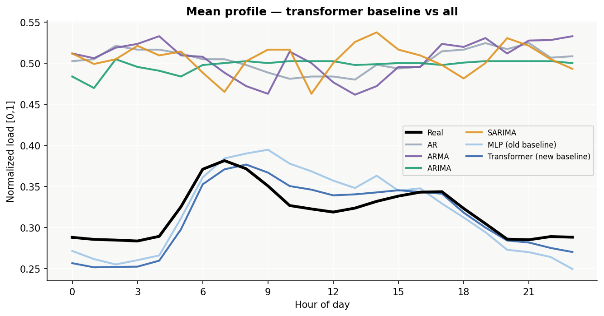
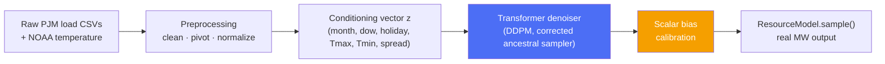
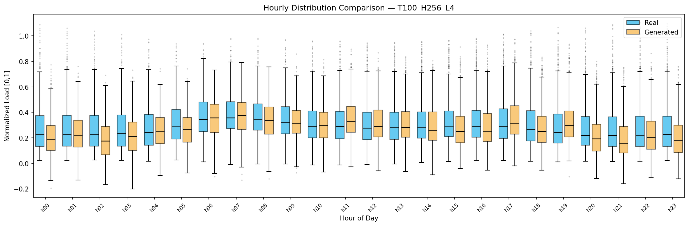

<div align="center">

# ⚡ enerdatasynth

### A research SDK for synthetic PJM energy resource profiles

[](LICENSE)
[](pyproject.toml)
[](tests/)
[](MIGRATION.md)

**Generate realistic synthetic electric-load profiles from a fitted diffusion model — no ML expertise required.**

```python
import enerdatasynth

load = enerdatasynth.model("pjm_load", zone="PS")
load.set(month=7, Tmax=86, Tmin=70, weekday=True)
samples = load.sample(n=100)   # (100, 24) — real MW, ready to use
```

[Quick Start](#-quick-start) · [Documentation](#-documentation) · [Model Card](MODEL_CARD.md) · [Benchmark Results](#-benchmark-results) · [Citation](#-citation)

</div>

<br>

<div align="center">


<sub>Mean daily profile — the validated transformer architecture (data/research_history/) vs. classical baselines vs. real PJM load. See <a href="#-benchmark-results">Benchmark Results</a> for numbers from the currently-shipped pipeline.</sub>
</div>

<br>

---

## Why this exists

Utilities, grid operators, and energy researchers frequently need realistic synthetic load data — for privacy-preserving data sharing, stress-testing forecasting models, or scenario planning — without exposing real customer or grid data. `enerdatasynth` wraps a validated conditional diffusion pipeline behind an SDK that hides every ML implementation detail: you describe a day (season, temperature, calendar type), and get back a realistic profile.

## ✨ Features

- **A fluent, implementation-hiding API** — `model()` → `.set()` → `.sample()`. No tensors, no checkpoint paths, no architecture classes ever surface.
- **A validated transformer architecture** — selected via a controlled 4-way architecture comparison (MLP/CNN/attention/transformer), not the first thing that was tried. See [Research Summary](#-research-summary).
- **A corrected diffusion sampler** — an earlier DDIM-style sampler was found to silently corrupt every result it touched; the fix is the only sampler shipped today.
- **Automatic bias calibration** — a systematic energy-error offset, diagnosed and corrected, applied automatically at generation time.
- **A common generator interface** (`BaseGenerator`) designed so a future resource type (e.g. wind) can be added through the same SDK contract — see [Extending](docs/extending.md).
- **Config-driven, YAML-first** hyperparameters (`data/configs/`), a real test suite (`tests/`, ~2–20s), and a full audit trail of every design decision ([MIGRATION.md](MIGRATION.md)) — nothing here is asserted without a file backing it.

## 🔌 Supported Generators

| Resource | Status | Zones | Entry point |
|---|---|---|---|
| Electric load | ✅ Available | `PS` (PJM/PSE&G, NJ) | `enerdatasynth.model("pjm_load", zone="PS")` |
| Wind | 🧩 Interface-ready, not implemented | — | See [`docs/extending.md`](docs/extending.md) — no wind data, model, or results exist in this project |

## 📦 Installation

```bash
pip install .                 # from a local clone
# or, once built:
pip install dist/*.whl
```

Both install paths — plus `pip install -e .` for development — are verified end-to-end (see [MIGRATION.md](MIGRATION.md) for what "verified" means here, including a real packaging bug that was only caught by actually installing the built wheel).

```bash
pip install ".[viz,dev]"      # + seaborn, + pytest/ruff/mypy/build/twine
```

## 🚀 Quick Start

```python
import enerdatasynth

load = enerdatasynth.model("pjm_load", zone="PS")
load.set(month=7, Tmax=86, Tmin=70, weekday=True, holiday=False)
samples = load.sample(n=100, seed=0)   # (100, 24) ndarray, MW
```

That's the whole interface for generation. Training a new model, if you want to reproduce or extend the results below:

```bash
enerdatasynth preprocess   # raw CSVs -> tensors
enerdatasynth train        # transformer, validated defaults
enerdatasynth calibrate --run-id transformer_T1000_H64_L2
```

See [`docs/quickstart.md`](docs/quickstart.md) for the full walkthrough and [`examples/`](examples/) for runnable scripts.

## 🏗️ Architecture



Full detail — why transformer over MLP/CNN/attention, why the ancestral sampler over DDIM, why calibration is scalar not per-hour — is in [`docs/architecture.md`](docs/architecture.md), with every claim traced to a specific result file.

## 📊 Evaluation Pipeline

Every comparison in this project uses the same 7-metric suite (`Hourly`, `FirstDiff`, `ACF`, `RMSE`, `Peak`, `Energy`, `Ramp` — all lower-is-better, defined in [`docs/evaluation.md`](docs/evaluation.md)), computed by `enerdatasynth.evaluation.metrics.compute_metrics`. The same suite backs the automatic failure-mode detector (`evaluation.failure_analysis`) and the benchmark script below.

<div align="center">

<br><sub>Per-hour distribution, real vs. generated — the currently auto-discovered default model (see Benchmark Results).</sub>
</div>

## 🏆 Benchmark Results

Run yourself: `python examples/run_benchmark.py --run-id <run_id>`. Numbers below are a real run against the full 600-day validation set, using the model `enerdatasynth.model("pjm_load")` actually auto-discovers today (the best currently-trained checkpoint under this package's own preprocessing pipeline):

| Model | Hourly↓ | FirstDiff↓ | ACF↓ | RMSE↓ | Peak↓ | Energy↓ | Ramp↓ |
|---|---|---|---|---|---|---|---|
| AR | 1.3533 | 0.4216 | 0.1458 | 0.1802 | 0.7557 | 4.2780 | 0.1242 |
| ARMA | 1.3581 | 0.4218 | **0.1081** | 0.1864 | 0.7557 | 4.3916 | 0.1239 |
| ARIMA | 1.3540 | 0.1698 | 0.3125 | 0.1813 | 0.3451 | 4.2945 | **0.0074** |
| SARIMA | 1.3625 | 0.6389 | 0.2489 | 0.1894 | 0.6834 | 4.4981 | 0.2969 |
| **enerdatasynth (default)** | **0.0590** | **0.0792** | 0.1347 | **0.0484** | **0.0362** | **0.8099** | 0.0647 |

Wins outright on 5 of 7 metrics against every classical baseline. ARMA edges it out on ACF, ARIMA on Ramp — reported honestly rather than rounded up to "wins everything." A separate, larger comparison against the validated transformer architecture (trained on a different conditioning scheme — see the caveat in [`docs/architecture.md`](docs/architecture.md)) shows an even larger margin; see [`docs/research_notes.md`](docs/research_notes.md).

## 📚 Documentation

| Page | Contents |
|---|---|
| [`docs/installation.md`](docs/installation.md) | Install paths, extras, reproducing exact results, GPU |
| [`docs/quickstart.md`](docs/quickstart.md) | Full walkthrough: preprocess → train → calibrate → sample |
| [`docs/architecture.md`](docs/architecture.md) | Model, sampler, schedule, calibration — with evidence |
| [`docs/api_reference.md`](docs/api_reference.md) | The full `model()`/`.set()`/`.sample()` contract |
| [`docs/evaluation.md`](docs/evaluation.md) | The 7-metric suite, calibration, benchmarking |
| [`docs/temperature_data.md`](docs/temperature_data.md) | NOAA temperature ingestion, zone-station mapping |
| [`docs/training.md`](docs/training.md) | Training new checkpoints, sweeps, configs |
| [`docs/packaging.md`](docs/packaging.md) | How this package is built, versioned, and verified |
| [`docs/developer_guide.md`](docs/developer_guide.md) | Project layout, testing, contribution standards |
| [`docs/extending.md`](docs/extending.md) | Adding a new resource type (e.g. wind) |
| [`docs/faq.md`](docs/faq.md) | Common questions |
| [`MODEL_CARD.md`](MODEL_CARD.md) | Training data, limitations, intended/out-of-scope use |
| [`MIGRATION.md`](MIGRATION.md) | Full audit trail behind every default in this package |

## 🧪 Examples

```bash
python examples/generate_samples.py           # LoadDiffusionModel round trip
python examples/run_full_pipeline.py           # tiny end-to-end demo
python examples/exploratory_data_analysis.py   # inspecting the processed dataset
```

## 🔬 Research Summary

- **A critical sampler bug, found and fixed.** An earlier sampler silently corrupted every diffusion result (values pinned near clamp bounds). Diagnosed and fixed; the corrected ancestral sampler is the only one shipped.
- **Architecture selected by controlled comparison, not assumption.** MLP vs CNN vs attention vs transformer, identical data/conditioning/schedule/seed. Transformer won on generated-profile quality at ~6x fewer parameters than the MLP it replaced (110,401 vs 688,408).
- **A methodological finding:** in that comparison, the *lowest validation loss* (CNN) was not the *best generated quality* (transformer) — a caution against judging generative models by training loss alone.
- **Calibration, evidence-checked rather than assumed better.** A more elaborate per-hour bias correction was tested and found *worse* on two metrics than the simpler scalar correction that's actually shipped.

Full detail, entirely traceable to specific files, is in [`docs/research_notes.md`](docs/research_notes.md) and [`MIGRATION.md`](MIGRATION.md).

## 📄 Citation

No accompanying paper has been published yet. If you use this software, please cite the repository:

```bibtex
@software{enerdatasynth,
  title  = {enerdatasynth: A Research SDK for Synthetic PJM Energy Resource Profiles},
  author = {Sharma, Sonakshi},
  year   = {2026},
  note   = {Software}
}
```

## ⚖️ License

[MIT](LICENSE) © 2026 Sonakshi Sharma

## 🗺️ Roadmap

- [ ] Re-validate the transformer/calibration pipeline under the package's current one-hot conditioning (see the caveat in [`docs/architecture.md`](docs/architecture.md))
- [ ] Multi-zone support (17 zones explored in `data/research_history/scripts/zone_expansion.py`, not yet promoted)
- [ ] A friendlier `set()` for `spread` (currently defaults to the training-set mean; see [`docs/api_reference.md`](docs/api_reference.md))
- [ ] Wind generation, once real data/research exists to back it (see [`docs/extending.md`](docs/extending.md))
- [ ] Re-sweep hyperparameters for the transformer architecture specifically (the current defaults are inherited from `data/research_history/`, never re-swept against this package's own pipeline)

Tracked in detail in [`data/reports/future_experiments.md`](data/reports/future_experiments.md) and [`MIGRATION.md`](MIGRATION.md).

---

<div align="center">
<sub>Implementation details, folder structure, and the full conditioning-vector spec have moved to <a href="docs/developer_guide.md">docs/developer_guide.md</a> — this file is a landing page, not a developer reference.</sub>
</div>
