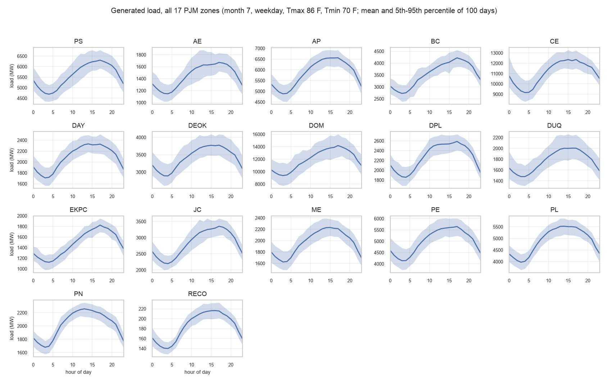
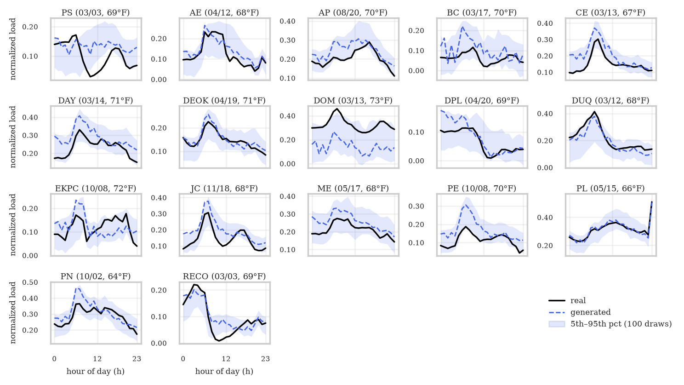

# PJM Load Model

`enerdatasynth.model("pjm_load", zone="PS")` (or any of the other 16 PJM zones) — synthetic
24-hour PJM electric load profiles, conditioned on calendar and temperature context.

This report is the scientific "report card" for this resource. For a shorter
introduction and installation, see the [root README](../../README.md). For the
line-by-line evidence behind every number here, see [`docs/research_status.md`](../research_status.md)
and [`docs/results.md`](../results.md) — this page summarizes and cross-links them
rather than repeating every derivation.

## 1. Overview

Generates a synthetic 24-hour electric load profile — one normalized or MW-scale value
per hour — for any of the 17 PJM zones (`PS` by default), conditioned on month, day-of-week,
holiday status, and daily temperature. Each zone has its own trained model. **This is a conditional generative model, not a forecaster**: it
samples a plausible profile consistent with given conditions, not a prediction of what
load will actually be on a specific future day.

## 2. Input Data

| Item | Value |
|---|---|
| Source | PJM `hrl_load_metered` hourly metered load |
| Time period | 2016–2025 |
| Temporal resolution | Hourly, pivoted to 24-column daily rows |
| Geographic structure | All 17 PJM zones with load and temperature data, one model each (§11); the detailed numbers in §3–§10 are for zone `PS` |
| Temperature source | NOAA Integrated Surface Database (ISD), equal-weighted average across each zone's constituent airport stations |
| DST handling | Days with 23 or 25 hourly rows are detected and excluded (a fixed 24-column row can't represent them) |
| Missing-data handling | Days with any missing load hour, or missing `Tmax`/`Tmin` after the temperature merge, are excluded — no imputation |
| Other exclusions | A COVID-period flag also excludes affected days (exact date range not independently re-verified in this pass) |
| Train/validation split | Chronological: 2016–2023 train / 2024–2025 validation |

Full detail: [`docs/data_card.md`](../data_card.md).

## 3. Data Representation

One sample is a `(24,)` vector — one value per hour, ordered `h00`…`h23` — representing
a single calendar day. Normalized to `[0,1]` per-hour (MinMax) by default; `.sample(units="MW")`
rescales to real MW using the scaler fit during preprocessing.

## 4. Conditioning

**Two different conditioning representations exist, and they are not interchangeable —
this is the single most important thing to know before quoting a result:**

| | Research configuration (validated results, §8) | Current package configuration |
|---|---|---|
| Dimensionality | 6 (raw, packed — "Z5" in the research history) | 23 (one-hot) |
| Encoding | Compact raw values | month one-hot (12) + day-of-week one-hot (7) + holiday binary (1) + Tmax/Tmin/spread z-scored (3) |
| Where it's used | Every Week 6/7 Transformer result | `enerdatasynth.model("pjm_load", ...).set(...)` today |

**The two give separate sets of results.** The Transformer's Week 6/7 results (§8) were
produced with the 6-dimensional research conditioning. The Transformer that ships as the
package default (`transformer_T1000_H64_L2`) was trained afterwards on the current
23-dimensional conditioning, so it has its own measured results, reported separately in
§8 under "Shipped default". Don't mix the two sets of numbers — see
[`docs/research_status.md`](../research_status.md) §C/§D.

## 5. Generative Model

A conditional DDPM (Denoising Diffusion Probabilistic Model). Two denoiser
architectures exist:

- **Transformer** (recommended, `DEFAULT_ARCHITECTURE`, and what ships): per-hour
  tokenization, learned positional embedding, sinusoidal timestep embedding,
  conditioning injected via a 2-layer SiLU MLP added to every token, standard
  `nn.TransformerEncoder` (`model_dim=64, num_heads=4, num_layers=2` by default).
  110,401 parameters in the architecture-comparison configuration (6-dim conditioning);
  111,489 in the shipped checkpoint, whose input layer takes the 23-dim conditioning.
- **MLP** (legacy baseline): 4 residual blocks, width 256, ~688,408 parameters in the
  same comparison; the specific bundled sweep checkpoint (`T100_H256_L4`) has 224,024
  parameters under different hyperparameters.

Diffusion: standard forward noising, plain MSE noise-prediction training loss, linear
beta schedule (`beta_start=1e-4, beta_end=0.02`, selected over cosine/quadratic — §8).
Sampling: standard **ancestral** DDPM reverse sampling, recomputing the noise
prediction fresh at every one of `T` reverse steps — the corrected replacement for a
historical sampler bug (an earlier implementation reused a prediction across steps; see
[`docs/research_status.md`](../research_status.md) §E). A regression test
(`tests/pjm_load/test_diffusion.py`) guards against reintroducing that bug.

**Which one does the package actually load?** `enerdatasynth.model("pjm_load", ...)`
resolves to the best available checkpoint by validation loss, preferring a
`"transformer"`-tagged run if one exists. One does: **`transformer_T1000_H64_L2`**, so the
package loads the Transformer, with its scalar calibration applied automatically. The
seven older checkpoints predate the `architecture` field, are treated as `"mlp"`, and
stay bundled as the legacy baseline.

## 6. Training

Standard DDPM training: AdamW, plain diffusion MSE loss (no auxiliary terms), best +
latest checkpoint saving, per-epoch CSV logs, optional early stopping (patience=10).
Config-driven via `RunConfig` / `data/configs/pjm_load/{transformer,mlp}.yaml`. The
Transformer's Week 7 run trained to convergence against the 6-dim research conditioning;
specific optimizer/LR/batch-size values for that exact run were not independently
re-verified against the current `training/train.py`.

The shipped default was trained with `data/configs/pjm_load/transformer.yaml` (seed 42:
`T=1000`, `hidden_dim=64`, `n_layers=2`, `n_heads=4`, `lr=3e-4`, `batch_size=64`) on CPU
in 144s. It early-stopped at epoch 163 (patience 40) with best validation loss 0.00946 at
epoch 123. Its calibration scalar is +0.02342, fit on 1,200 training days with seed 42.
For comparison, the bundled MLP sweep's best config (`T100_H256_L4`) trained in 6.7s.

## 7. Evaluation

Seven metrics, all lower-is-better, implemented once in
`enerdatasynth.resources.pjm_load.evaluation.metrics.compute_metrics`:

| Metric | What it measures | Why it matters |
|---|---|---|
| `Hourly` | Per-hour mean + interquartile-range mismatch (a project-specific composite, not a standard named statistic) | Overall shape and spread fidelity across the day |
| `FirstDiff` | Mismatch in hour-to-hour volatility (std of first differences) | Captures whether generated profiles are too smooth or too noisy |
| `ACF` | Mismatch in temporal autocorrelation (lags 0–12) | Captures whether daily temporal structure is preserved, not just marginal values |
| `RMSE` | Root-mean-square error of the mean profile shape | Headline shape-fidelity number |
| `Peak` | Mismatch in average daily peak | Peak load is operationally the most consequential single value |
| `Energy` | Mismatch in average total daily energy (sum of 24 hours) | Directly sensitive to a systematic level bias — see calibration, §12 |
| `Ramp` | Mismatch in average hour-to-hour ramp magnitude | Relevant to grid operations (ramping capability), not just static shape |

## 8. Quantitative Results

**Architecture comparison** (Week 6, controlled: identical data/conditioning/schedule/seed):

| Architecture | Params | RMSE | Peak | Energy | Train time |
|---|---|---|---|---|---|
| MLP | 688,408 | 0.0241 | 0.0116 | 0.0833 | 2.8 min |
| CNN | 158,401 | 0.0231 | 0.0009 | 0.1072 | **118.0 min (unexplained)** |
| Attention | 60,417 | 0.0220 | 0.0092 | 0.0582 | 2.9 min |
| **Transformer** | 110,401 | **0.0215** | **0.0003** | 0.0750 | 4.4 min |

**Head-to-head vs. classical baselines** (Week 7, Transformer trained to convergence):

| Model | RMSE | Peak | Energy | Beats classical 7/7? |
|---|---|---|---|---|
| Best classical (ARIMA) | 0.1808 | 0.3124 | 4.2818 | — |
| MLP (old baseline) | 0.0259 | 0.0115 | **0.0008** | Yes |
| **Transformer (new baseline)** | **0.0195** | **0.0089** | 0.1405 | **Yes, 7/7** |

Transformer beats the MLP on 6 of 7 metrics at ~6× fewer parameters; the one metric it
loses (`Energy`) is fixed by calibration (§12). These are the Week 6/7 numbers, with the
6-dim research conditioning.

**Shipped default** (`transformer_T1000_H64_L2`, trained on the package's own 23-dim
conditioning). Mean over 5 generation seeds on the 600 validation days, normalized units,
lower is better. Each model was trained once, so the spread covers sampling noise only.
Reproduce with `examples/pjm_load/compare_checkpoints.py` (writes
`data/reports/pjm_load/checkpoint_comparison.csv`):

| Model | Hourly | FirstDiff | ACF | RMSE | Peak | Energy | Ramp |
|---|---|---|---|---|---|---|---|
| Legacy MLP (`T100_H256_L4`) | 0.0586 | 0.0788 | 0.1363 | 0.0465 | 0.0404 | 0.7699 | 0.0646 |
| Transformer, uncalibrated | 0.0486 | 0.0005 | 0.0307 | 0.0265 | 0.0358 | 0.5159 | 0.0008 |
| **Transformer, calibrated (shipped)** | **0.0395** | **0.0005** | **0.0307** | **0.0156** | **0.0124** | **0.0462** | **0.0008** |

The Transformer beats this MLP on all seven metrics in all five seeds, even before
calibration.

A caution about the legacy MLP above: it is the research-phase run (at most 60 epochs, no per-zone tuning), and it turned out to be under-trained. Trained with the same protocol as the Transformer (400 epochs maximum, early stopping, the same calibration step) and tuned over three configurations, an MLP denoiser reaches an RMSE of about 0.022 on PS, not 0.0465. The Transformer's advantage is therefore smaller than this table suggests: it stays large on temporal structure (first difference, autocorrelation, ramp) and on distribution fidelity (MMD), and is modest on RMSE. The fair comparison, across all 17 zones, is in §11.

 Against the classical baselines (AR/ARMA/ARIMA/SARIMA, single run,
`data/reports/pjm_load/benchmark_comparison.csv`) the shipped model also wins on all
seven: for example RMSE 0.0153 vs. the best classical 0.182, and ACF 0.0315 vs. 0.107.

These shipped-model numbers are a different experiment from the Week 7 table above
(different conditioning, one training run) and shouldn't be merged with it. Full tables:
[`docs/results.md`](../results.md).

## 9. Actual vs. Generated Examples


Six representative validation days (coldest, hottest, spring/fall/weekend near-median,
and overall-median `Tmax`), each showing the **real** profile against a **generated**
one sampled from the *exact same conditioning vector* — generated live, from the
package's shipped default checkpoint (`transformer_T1000_H64_L2`, calibrated; see §5),
sampled once with a fixed seed. Reproduce with `examples/pjm_load/plot_real_vs_generated.py`. The
days are chosen by a rule on `Tmax`, not by looking at the output.

**Read honestly:** the model tracks the real shape well on the mild days (spring, fall,
weekend, overall median) and on the coldest day, including the morning peak. The
**hottest day is still clearly under-generated**, and its evening trend runs the wrong
way. That day (102°F) is above anything in the training data: 8 of the 600 validation days
have real load above the training maximum (normalized load up to 1.105), so extreme heat
is an extrapolation case. This matches the hot-day weakness in §10/§13. The previous
version of this figure, from the legacy MLP, was visibly jagged and missed the hottest
day by about 0.4 in normalized load.

**To reproduce this figure:** get the PJM and NOAA source files yourself (§2), put them in
`data/raw/pjm_load/`, then run

```bash
enerdatasynth preprocess
python examples/pjm_load/plot_real_vs_generated.py
```

It writes `docs/assets/pjm_load_real_vs_generated.png`. The seed and the day-selection
rule are fixed, so the same data gives the same figure.

## 10. Conditional / Regime Evaluation

Post-convergence Transformer, validation-set slices (research conditioning):

| Group | Slice | RMSE |
|---|---|---|
| Temperature | Cold (bottom 25%) | 0.0260 |
| Temperature | Mild (mid 50%) | 0.0209 |
| Temperature | Hot (top 25%) | 0.0205 |
| Calendar | Weekday | 0.0230 |
| Calendar | Weekend | 0.0195 |
| Calendar | Holiday (n=17) | 0.0306 (hardest — small sample) |
| Season | Winter | 0.0283 |
| Season | Summer | 0.0266 |

A separate, sharper finding from error analysis: hot-condition days are **over-represented
2.7× among the worst-generated 10% of days** (68.3% vs. a 25.3% baseline rate) — a real,
unresolved weakness the aggregate RMSE table above doesn't fully surface. Full detail:
[`docs/results.md`](../results.md) §4/§7.

## 11. Multi-Zone Results

All 17 PJM zones that have both load and temperature data ship with their own model: PS, AE, AP, BC, CE, DAY, DEOK, DOM, DPL, DUQ, EKPC, JC, ME, PE, PL, PN and RECO. Each zone's model is the shipped Transformer (`transformer_T1000_H64_L2`: T=1000, hidden 64, 2 layers, 4 heads, learning rate 3e-4, batch 64, seed 42, early stopping on validation loss) trained on that zone's own 2016–2023 days with the package's own preprocessing and 23-dim conditioning, then calibrated. Only the load data, the scalers and the temperature column differ between zones. `examples/pjm_load/train_all_zones.py` builds them all; running it for PS reproduces the shipped PS weights exactly (byte for byte).

Scores below are on each zone's 2024–2025 validation days (3 generation seeds, normalized units, lower is better), from `data/reports/pjm_load/zone_results.csv`, produced by `examples/pjm_load/evaluate_all_zones.py`. The last two columns describe the data, not the model.

| Zone | Train / val days | RMSE (raw → calibrated) | Energy (raw → calibrated) | Peak | ACF | Load level, val ÷ train | Val days above train max |
|---|---|---|---|---|---|---|---|
| DUQ | 2785 / 602 | 0.0165 → 0.0121 | 0.275 → 0.047 | 0.0082 | 0.0361 | 1.001 | 0.3% |
| CE | 2785 / 600 | 0.0183 → 0.0123 | 0.330 → 0.058 | 0.0066 | 0.0303 | 0.987 | 0.0% |
| DEOK | 2785 / 602 | 0.0160 → 0.0129 | 0.353 → 0.274 | 0.0049 | 0.0115 | 1.001 | 0.3% |
| AP | 2785 / 602 | 0.0212 → 0.0135 | 0.472 → 0.262 | 0.0164 | 0.0131 | 1.012 | 0.8% |
| PN | 2785 / 602 | 0.0135 → 0.0145 | 0.258 → 0.290 | 0.0138 | 0.0127 | 0.987 | 0.0% |
| JC | 2785 / 600 | 0.0241 → 0.0150 | 0.470 → 0.122 | 0.0138 | 0.0186 | 0.993 | 0.7% |
| PS | 2785 / 600 | 0.0264 → 0.0153 | 0.519 → 0.043 | 0.0125 | 0.0296 | 0.999 | 1.3% |
| BC | 2785 / 602 | 0.0216 → 0.0165 | 0.362 → 0.139 | 0.0288 | 0.0812 | 0.992 | 0.7% |
| DAY | 2785 / 602 | 0.0138 → 0.0184 | 0.248 → 0.384 | 0.0272 | 0.0180 | 1.015 | 1.7% |
| PE | 2785 / 602 | 0.0094 → 0.0191 | 0.142 → 0.425 | 0.0194 | 0.0229 | 0.988 | 0.3% |
| PL | 2785 / 602 | 0.0197 → 0.0200 | 0.270 → 0.283 | 0.0166 | 0.0158 | 1.011 | 0.3% |
| DPL | 2785 / 602 | 0.0337 → 0.0203 | 0.708 → 0.287 | 0.0239 | 0.0200 | 1.017 | 1.5% |
| AE | 2628 / 600 | 0.0232 → 0.0228 | 0.105 → 0.042 | 0.0091 | 0.0263 | 0.988 | 0.0% |
| RECO | 2785 / 600 | 0.0229 → 0.0233 | 0.020 → 0.101 | 0.0149 | 0.0251 | 0.997 | 0.3% |
| ME | 2785 / 602 | 0.0110 → 0.0236 | 0.042 → 0.503 | 0.0228 | 0.0101 | 0.985 | 0.2% |
| **EKPC** | 2785 / 602 | 0.0396 → 0.0494 | 0.936 → 1.174 | 0.0514 | 0.0382 | 1.090 | 0.8% |
| **DOM** | 2785 / 602 | 0.2046 → 0.2022 | 4.887 → 4.830 | 0.1980 | 0.0911 | 1.219 | 7.8% |



*Generated load for each zone model (July weekday, 86/70 °F; mean and 5th–95th percentile of 100 days, each in its own zone's megawatts). Made by `examples/pjm_load/plot_all_zones.py` from the shipped models alone; it is generated output, not a comparison with real load.*



*Real versus generated for every zone. One 2024 validation day per zone, chosen by a fixed rule (the day nearest the zone's median validation `Tmax`), with the real profile (black), one generated profile for the same condition vector (dashed) and the 5th–95th percentile of 100 draws (band). Each panel has its own scale. The real profile lies inside the band for a median of 22 of 24 hours, and for at least 18 hours in 15 of the 17 zones; PS (10 hours) and RECO (13) are the weakest on these days. DOM's generated level is far below the real one, the load-growth effect described above. Made by `examples/pjm_load/plot_real_vs_generated_all_zones.py`; it needs the preprocessed arrays for every zone.*

What the table says:

- **15 of 17 zones are modeled about as well as PS.** Calibrated RMSE runs from 0.0121 (DUQ) to 0.0236 (ME), median 0.0165, against 0.0153 for PS.
- **DOM and EKPC are the exceptions, and the reason is the data, not the pipeline.** DOM's load grew 39% between 2016 (11.2 GW mean) and 2025 (15.5 GW), which is consistent with data-center growth. Its 2024–2025 validation days average 22% above its 2016–2023 training days, and 7.8% of them have an hour above the training maximum. A model that sees only calendar and weather conditions cannot know the level moved, so it generates days at the old level: RMSE 0.20, with a Peak error (0.198) nearly as large, which is what a model unable to reach the new, higher loads looks like. EKPC shows the same pattern more mildly (+9% level, RMSE 0.049). The earlier research phase measured the same DOM failure with a different conditioning and left the cause undiagnosed. Treat DOM, and to a lesser degree EKPC, as generating the 2016–2023 load level.
- **Calibration helps where a zone's load level is stable and can hurt where it drifts.** The scalar offset is fit on training days only (1,200 of them), as for PS. On the validation days it lowers RMSE in 9 zones (PS, AP, BC, CE, DEOK, DOM, DPL, DUQ, JC) and raises it in 5 (DAY, EKPC, ME, PE, PN), with PL and RECO unchanged; Energy error falls in 9 zones and rises in 6. Where the validation level differs from the training level, a bias measured on training days does not transfer. It is applied by default for every zone, so the shipped behavior is the same pipeline everywhere. To see the raw model instead, call `generate_load_profile(..., apply_calibration=False)` or load the checkpoint with `LoadDiffusionModel.from_run_id(..., use_calibration=False, zone=...)`.
- **AE has 2,628 training days, not 2,785.** AE reports its load as AECO plus VMEU from June 2017 (before that, as one area, `AE`), so preprocessing drops 1 January to 31 May 2017, when VMEU is missing.
- **Several zones are sums of load areas.** AE (AECO + VMEU), DPL (DPLCO + EASTON) and PL (PLCO + UGI) report more than one area per zone. Preprocessing sums them. The research-phase script averaged them, so its normalized scores for those three zones were fine but its MW were not zone totals.

The research phase, which used the older 6-dim conditioning, found 16 of 17 zones with RMSE 0.0086–0.0436 and DOM at 0.1998. The new run agrees on every conclusion except that EKPC is now also an outlier, and it adds the explanation for DOM. Choosing zones: pass `zone=` to `enerdatasynth.model("pjm_load", zone=...)`; nothing else about the call changes.

### Against a tuned MLP denoiser

Because the research-phase MLP was under-trained (§8), the Transformer was also compared with an MLP denoiser given the same training protocol and a small per-zone tuning, in every zone: three MLP configurations (`T=100`, hidden 256, 4 blocks; `T=200`, 128, 4; `T=1000`, 256, 4), best per zone by validation RMSE (an oracle choice that favors the MLP). The Transformer is not tuned. Scores are in `data/reports/pjm_load/diffusion_zone_comparison.csv` (10 metrics, with and without calibration, 3 generation seeds); `examples/pjm_load/compare_diffusion_zones.py` reproduces them.

With calibration on both models, the Transformer has the lower value in:

| Metric | Zones won (of 17) | Median, 15 normal zones (Transformer vs MLP) |
|---|---|---|
| FirstDiff, ACF, Ramp | 17, 17, 17 | 0.0024 vs 0.0468; 0.0200 vs 0.0991; 0.0021 vs 0.0396 |
| MMD² | 16 | 0.0068 vs 0.0181 |
| RMSE, paired RMSE | 15, 15 | 0.0165 vs 0.0256; 0.0801 vs 0.0933 |
| Wasserstein W₁ | 14 | 0.0213 vs 0.0267 |
| Hourly, Peak | 13, 13 | 0.0373 vs 0.0433; 0.0149 vs 0.0487 |
| Energy | 12 (5 without calibration) | 0.262 vs 0.228 |

So the Transformer is clearly better on how a day's shape evolves and on the distribution of days, and modestly better on RMSE. Daily energy is the exception: the MLP's uncalibrated daily energy is closer (it wins 12 of 17 zones without calibration), and calibration is what brings the Transformer level. On PS the MLP also wins Hourly and W₁. DOM is poorly modeled by both (RMSE 0.18 to 0.21) for the reason given above. Simple non-diffusion conditional models (a linear-Gaussian model and a conditional VAE) were not part of this comparison; an earlier look at PS found them competitive with both diffusion models on several metrics, so no claim is made against them.

## 12. Calibration

The trained denoiser reproduces daily *shape* well but carries a small systematic
per-hour level offset that compounds ~24× into the `Energy` metric. A scalar
correction — one number added to every hour — fixes this:

- **Fit on 1,200 training days only, never validation.**
- Cuts `Energy` error 66% (0.1644 → 0.0563) at **zero cost** to `FirstDiff`/`ACF`/`Ramp`
  (mathematically invariant under a constant shift).
- A more elaborate per-hour correction was tested and found *worse* on `ACF`/`RMSE` —
  scalar is the validated choice, not the untested default.
- **Train-fit, not independently re-validated** beyond the 1,200-day sample it was
  measured on.
- **The shipped default carries one.** `transformer_T1000_H64_L2/calibration.json`
  holds a scalar of +0.02342, fit on 1,200 training days with seed 42, and is applied
  automatically at generation. On the 23-dim conditioning it cuts `Energy` error from
  0.516 to 0.046 (5-seed means), alongside gains on `Peak` (0.036 to 0.012), `RMSE`
  (0.027 to 0.016), and `Hourly` (0.049 to 0.040). The seven legacy MLP checkpoints have
  none, so they sample uncalibrated.

## 13. Limitations

1. The Week 6/7 Transformer results use research conditioning (6-dim). The shipped
   Transformer was trained on the package's 23-dim conditioning and measured separately
   (§8), from a single training run with the validated-in-research hyperparameters, not a
   from-scratch sweep.
2. The shipped checkpoint's validation loss (0.00946, `T=1000`) is not comparable to the
   legacy MLPs' (`T=100`); the choice of default rests on the generated-profile metrics.
3. Extreme heat is under-generated (§9), and the uncalibrated winter mean runs about 11%
   low before the calibration offset is applied.
4. DOM (and, less so, EKPC) is poorly modeled because its load level moved between the training and validation years (§11); the zones are otherwise comparable to PS. Calibration, fit on training days, can hurt zones whose level drifts (§11).
5. Hot-condition days are a measurable, unresolved weak point.
6. Calibration's validation is limited to its own fitting sample.
7. In-sample validation methodology (same conditioning vectors as real validation days)
   tests conditional fidelity, not out-of-distribution generalization.
8. An unexplained 118-minute CNN training-time anomaly appears in the architecture
   comparison and was never investigated.

## 14. Reproduction

Raw source data is not bundled with this repository (§2) — supply your own copy of the
PJM/NOAA files under `data/raw/pjm_load/` first (see the placeholder file
there for exactly which files and where to get them). Generation itself (`.sample()`)
does not need raw data at all — only retraining/re-preprocessing does:

```bash
enerdatasynth preprocess                                 # raw CSVs -> tensors
enerdatasynth train                                      # transformer, validated defaults
enerdatasynth calibrate --run-id <the new run's run_id>
enerdatasynth evaluate --run-id <the new run's run_id>
```

This is how the shipped default was produced: a Transformer trained against the
**current package conditioning**, which makes it a new experiment rather than a
reproduction of the Week 7 numbers in §8 (see §4). Re-running it with seed 42 should
give a very similar model, though bit-exact reproduction across machines isn't promised.
Reproducing the Week 7 numbers exactly would additionally require the research-lineage
6-dimensional conditioning, which the current `enerdatasynth preprocess` does not
produce. See [`docs/training.md`](../training.md) for the full workflow.

For another zone, add `--zone` to each command (`enerdatasynth preprocess --zone DOM`, and so on). To rebuild and score all 17 zones in one go:

```bash
python examples/pjm_load/train_all_zones.py --raw-dir /path/to/raw --workdir /tmp/eds_zones
python examples/pjm_load/evaluate_all_zones.py --workdir /tmp/eds_zones
```

Run that way, PS reproduces the shipped PS weights exactly (the file is byte-identical); the one thing that differs between runs is the calibration scalar, which is fit on a random 1,200 of the training days (+0.0234 for the shipped PS model, +0.0259 in the check run).

## 15. Intended Use and Out-of-Scope Uses

**Intended**: generating synthetic daily load profiles for research on load-shape
modeling, scenario analysis, or data augmentation where real metered data is limited or
sensitive; studying conditional generative modeling techniques (diffusion, conditioning
strategies, calibration) on a real-world time-series domain.

**Out of scope**:

- **Not a forecasting model.** Does not predict actual future load values (§1).
- **Not an operational dispatch or grid-control system.** No output from this model
  should inform real-time grid operations.
- **Not a causal model.** Conditioning variables (temperature, calendar) shape the
  generated distribution; they are not validated as causal drivers.
- **Not a guarantee for every zone's current load level.** DOM and, less so, EKPC grew faster than the 2016–2023 training years (§11); their models generate the older level.
- **Not a guarantee of physical feasibility.** Generated profiles are statistically
  plausible, not verified against grid physics or operational constraints.
- **Not evaluated for privacy guarantees.** No differential-privacy or re-identification
  analysis was performed; don't rely on generated profiles as a certified anonymization
  mechanism.

## 16. Ethical / Operational Considerations

Do not use generated profiles as a substitute for real metered data in any context where
the distinction matters operationally (billing, settlement, grid planning, forecasting).
Generated data should be clearly labeled as synthetic in any downstream use.

## 17. Versioning

The package version is `enerdatasynth.__version__`. Release history is in `MIGRATION.md`,
and how releases are built and published is in `docs/packaging.md`.
