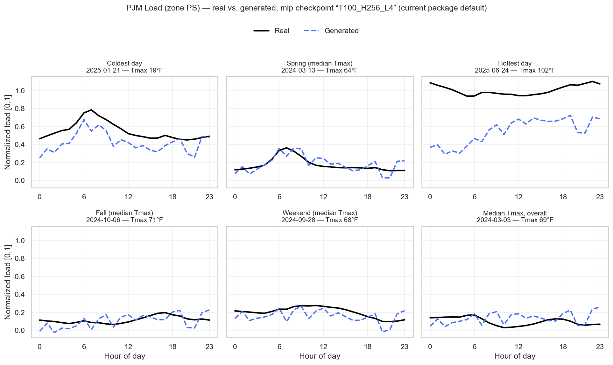

# PJM Load Model

`enerdatasynth.model("pjm_load", zone="PS")` — synthetic 24-hour PJM electric load
profiles, conditioned on calendar and temperature context.

This report is the scientific "report card" for this resource. For a shorter
introduction and installation, see the [root README](../../README.md). For the
line-by-line evidence behind every number here, see [`docs/research_status.md`](../research_status.md)
and [`docs/results.md`](../results.md) — this page summarizes and cross-links them
rather than repeating every derivation.

## 1. Overview

Generates a synthetic 24-hour electric load profile — one normalized or MW-scale value
per hour — for PJM zone `PS`, conditioned on month, day-of-week, holiday status, and
daily temperature. **This is a conditional generative model, not a forecaster**: it
samples a plausible profile consistent with given conditions, not a prediction of what
load will actually be on a specific future day.

## 2. Input Data

| Item | Value |
|---|---|
| Source | PJM `hrl_load_metered` hourly metered load |
| Time period | 2016–2025 |
| Temporal resolution | Hourly, pivoted to 24-column daily rows |
| Geographic structure | Zone `PS` packaged; 16 additional PJM zones researched (§11) |
| Temperature source | NOAA Integrated Surface Database (ISD), equal-weighted average across each zone's constituent airport stations |
| DST handling | Days with 23 or 25 hourly rows are detected and excluded (a fixed 24-column row can't represent them) |
| Missing-data handling | Days with any missing load hour, or missing `Tmax`/`Tmin` after the temperature merge, are excluded — no imputation |
| Other exclusions | A COVID-period flag also excludes affected days (exact date range not independently re-verified in this pass) |
| Train/validation split | Chronological: 2016–2023 train / 2024–2025 validation |

Full detail: [`docs/data_card.md`](../data_card.md).

## 3. Data Representation

One sample is a `(24,)` vector — one value per hour, ordered `h00`…`h23` — representing
a single calendar day. Normalized to `[0,1]` per-hour (MinMax) by default; `.sample(units="MW")`
rescales to real MW using the scaler fit during preprocessing.

## 4. Conditioning

**Two different conditioning representations exist, and they are not interchangeable —
this is the single most important thing to know before quoting a result:**

| | Research configuration (validated results, §8) | Current package configuration |
|---|---|---|
| Dimensionality | 6 (raw, packed — "Z5" in the research history) | 23 (one-hot) |
| Encoding | Compact raw values | month one-hot (12) + day-of-week one-hot (7) + holiday binary (1) + Tmax/Tmin/spread z-scored (3) |
| Where it's used | Every Week 6/7 Transformer result | `enerdatasynth.model("pjm_load", ...).set(...)` today |

**No checkpoint bridges the two.** The Transformer's validated results (§8) were
produced with the 6-dimensional research conditioning; no Transformer checkpoint has
been trained against the current 23-dimensional package conditioning. This is disclosed
directly in the code (`src/enerdatasynth/resources/pjm_load/models/transformer.py`'s module docstring) and
is not a documentation oversight — see [`docs/research_status.md`](../research_status.md) §C/§D.

## 5. Generative Model

A conditional DDPM (Denoising Diffusion Probabilistic Model). Two denoiser
architectures exist:

- **Transformer** (recommended, `DEFAULT_ARCHITECTURE`): per-hour tokenization, learned
  positional embedding, sinusoidal timestep embedding, conditioning injected via a
  2-layer SiLU MLP added to every token, standard `nn.TransformerEncoder`
  (`model_dim=64, num_heads=4, num_layers=2` by default). 110,401 parameters in the
  architecture-comparison configuration (6-dim conditioning).
- **MLP** (legacy baseline): 4 residual blocks, width 256, ~688,408 parameters in the
  same comparison; the specific bundled sweep checkpoint (`T100_H256_L4`) has 224,024
  parameters under different hyperparameters.

Diffusion: standard forward noising, plain MSE noise-prediction training loss, linear
beta schedule (`beta_start=1e-4, beta_end=0.02`, selected over cosine/quadratic — §8).
Sampling: standard **ancestral** DDPM reverse sampling, recomputing the noise
prediction fresh at every one of `T` reverse steps — the corrected replacement for a
historical sampler bug (an earlier implementation reused a prediction across steps; see
[`docs/research_status.md`](../research_status.md) §E). A regression test
(`tests/pjm_load/test_diffusion.py`) guards against reintroducing that bug.

**Which one does the package actually load?** `enerdatasynth.model("pjm_load", ...)`
today resolves to the best available checkpoint by validation loss, preferring a
`"transformer"`-tagged run if one exists. **None currently exists** — every bundled
checkpoint predates the `architecture` field and is treated as `"mlp"` — so the package
currently loads the **legacy MLP baseline**, not the Transformer described above as
recommended. See §14 for how to close this gap.

## 6. Training

Standard DDPM training: AdamW, plain diffusion MSE loss (no auxiliary terms), best +
latest checkpoint saving, per-epoch CSV logs, optional early stopping (patience=10).
Config-driven via `RunConfig` / `data/configs/pjm_load/{transformer,mlp}.yaml`. The Transformer's
validated training run (Week 7) trained to convergence against the 6-dim research
conditioning; specific optimizer/LR/batch-size values for that exact run were not
independently re-verified against the current `training/train.py` in this documentation
pass. Runtime for the bundled MLP sweep's best config: 6.7s (`T100_H256_L4`, 50 epochs).

## 7. Evaluation

Seven metrics, all lower-is-better, implemented once in
`enerdatasynth.resources.pjm_load.evaluation.metrics.compute_metrics`:

| Metric | What it measures | Why it matters |
|---|---|---|
| `Hourly` | Per-hour mean + interquartile-range mismatch (a project-specific composite, not a standard named statistic) | Overall shape and spread fidelity across the day |
| `FirstDiff` | Mismatch in hour-to-hour volatility (std of first differences) | Captures whether generated profiles are too smooth or too noisy |
| `ACF` | Mismatch in temporal autocorrelation (lags 0–12) | Captures whether daily temporal structure is preserved, not just marginal values |
| `RMSE` | Root-mean-square error of the mean profile shape | Headline shape-fidelity number |
| `Peak` | Mismatch in average daily peak | Peak load is operationally the most consequential single value |
| `Energy` | Mismatch in average total daily energy (sum of 24 hours) | Directly sensitive to a systematic level bias — see calibration, §12 |
| `Ramp` | Mismatch in average hour-to-hour ramp magnitude | Relevant to grid operations (ramping capability), not just static shape |

## 8. Quantitative Results

**Architecture comparison** (Week 6, controlled: identical data/conditioning/schedule/seed):

| Architecture | Params | RMSE | Peak | Energy | Train time |
|---|---|---|---|---|---|
| MLP | 688,408 | 0.0241 | 0.0116 | 0.0833 | 2.8 min |
| CNN | 158,401 | 0.0231 | 0.0009 | 0.1072 | **118.0 min (unexplained)** |
| Attention | 60,417 | 0.0220 | 0.0092 | 0.0582 | 2.9 min |
| **Transformer** | 110,401 | **0.0215** | **0.0003** | 0.0750 | 4.4 min |

**Head-to-head vs. classical baselines** (Week 7, Transformer trained to convergence):

| Model | RMSE | Peak | Energy | Beats classical 7/7? |
|---|---|---|---|---|
| Best classical (ARIMA) | 0.1808 | 0.3124 | 4.2818 | — |
| MLP (old baseline) | 0.0259 | 0.0115 | **0.0008** | Yes |
| **Transformer (new baseline)** | **0.0195** | **0.0089** | 0.1405 | **Yes, 7/7** |

Transformer beats the MLP on 6 of 7 metrics at ~6× fewer parameters; the one metric it
loses (`Energy`) is fixed by calibration (§12). Full tables, including the package's own
live benchmark against its actual current default checkpoint (beats every classical
baseline on 5 of 7 metrics under the current 23-dim conditioning): [`docs/results.md`](../results.md).

## 9. Actual vs. Generated Examples



Six representative validation days (coldest, hottest, spring/fall/weekend near-median,
and overall-median `Tmax`), each showing the **real** profile against a **generated**
one sampled from the *exact same conditioning vector* — generated live, from the
package's actual current default checkpoint (`T100_H256_L4`, MLP architecture; see §5)
for this documentation pass, not a cherry-picked historical figure.

**Read honestly:** the model tracks the real daily shape well for mild-temperature days
(spring, fall, weekend, median), and visibly struggles at both temperature extremes
(coldest and — especially — hottest day), consistent with §10/§13's hot-day weakness
finding. This figure shows the *current default* (MLP) checkpoint's real behavior, not
the better-performing Transformer's (which has no compatible bundled checkpoint — §4).

## 10. Conditional / Regime Evaluation

Post-convergence Transformer, validation-set slices (research conditioning):

| Group | Slice | RMSE |
|---|---|---|
| Temperature | Cold (bottom 25%) | 0.0260 |
| Temperature | Mild (mid 50%) | 0.0209 |
| Temperature | Hot (top 25%) | 0.0205 |
| Calendar | Weekday | 0.0230 |
| Calendar | Weekend | 0.0195 |
| Calendar | Holiday (n=17) | 0.0306 (hardest — small sample) |
| Season | Winter | 0.0283 |
| Season | Summer | 0.0266 |

A separate, sharper finding from error analysis: hot-condition days are **over-represented
2.7× among the worst-generated 10% of days** (68.3% vs. a 25.3% baseline rate) — a real,
unresolved weakness the aggregate RMSE table above doesn't fully surface. Full detail:
[`docs/results.md`](../results.md) §4/§7.

## 11. Multi-Zone Results

17 PJM zones researched with the identical pipeline (Transformer, corrected sampler,
calibration) — only load data, scaler parameters, and temperature column differ per
zone:

| | RMSE |
|---|---|
| Best (AP) | 0.0086 |
| 16-zone range | 0.0086 – 0.0436 |
| **DOM (unresolved outlier)** | **0.1998** (~4.6× the next-worst zone) |

**16 of 17 zones generalize well; DOM does not, and this is not fixed.** No root cause
has been diagnosed for DOM's failure. **Only zone `PS` is exposed by the installed
package today** — this is a research finding, not yet wired into `pjm_load`'s supported
zone list. Full table: [`docs/results.md`](../results.md) §8.

## 12. Calibration

The trained denoiser reproduces daily *shape* well but carries a small systematic
per-hour level offset that compounds ~24× into the `Energy` metric. A scalar
correction — one number added to every hour — fixes this:

- **Fit on 1,200 training days only, never validation.**
- Cuts `Energy` error 66% (0.1644 → 0.0563) at **zero cost** to `FirstDiff`/`ACF`/`Ramp`
  (mathematically invariant under a constant shift).
- A more elaborate per-hour correction was tested and found *worse* on `ACF`/`RMSE` —
  scalar is the validated choice, not the untested default.
- **Train-fit, not independently re-validated** beyond the 1,200-day sample it was
  measured on.
- **No bundled checkpoint currently ships a `calibration.json`** — default package
  sampling is uncalibrated today.

## 13. Limitations

1. Reported Transformer results use research conditioning (6-dim); the package's own
   preprocessing (23-dim) has not been used to produce or verify any of them.
2. The package currently defaults to the legacy MLP checkpoint, not the Transformer.
3. Default sampling is uncalibrated (no bundled `calibration.json`).
4. Only 1 of 17 researched zones is packaged; DOM fails badly among the 17.
5. Hot-condition days are a measurable, unresolved weak point.
6. Calibration's validation is limited to its own fitting sample.
7. In-sample validation methodology (same conditioning vectors as real validation days)
   tests conditional fidelity, not out-of-distribution generalization.
8. An unexplained 118-minute CNN training-time anomaly appears in the architecture
   comparison and was never investigated.

## 14. Reproduction

Raw source data is not bundled with this repository (§2) — supply your own copy of the
PJM/NOAA files under `data/raw/pjm_load/` first (see the placeholder file
there for exactly which files and where to get them). Generation itself (`.sample()`)
does not need raw data at all — only retraining/re-preprocessing does:

```bash
enerdatasynth preprocess                                 # raw CSVs -> tensors
enerdatasynth train                                      # transformer, validated defaults
enerdatasynth calibrate --run-id <the new run's run_id>
enerdatasynth evaluate --run-id <the new run's run_id>
```

This trains a Transformer against the **current package conditioning** — a genuinely
new experiment, not an automatic reproduction of the Week 7 numbers in §8 (see §4).
Reproducing the Week 7 numbers exactly would additionally require the research-lineage
6-dimensional conditioning, which the current `enerdatasynth preprocess` does not
produce. See [`docs/training.md`](../training.md) for the full workflow.
