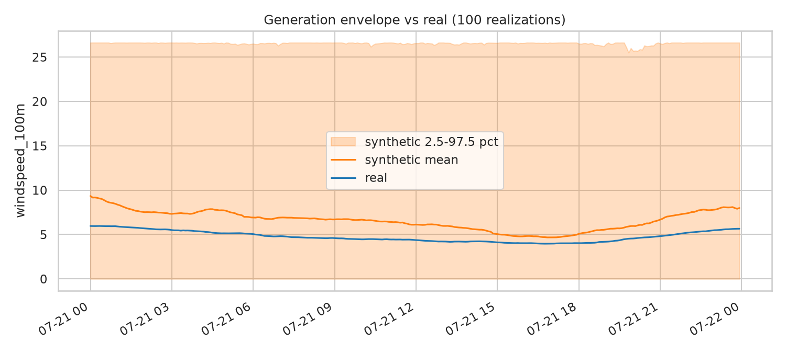
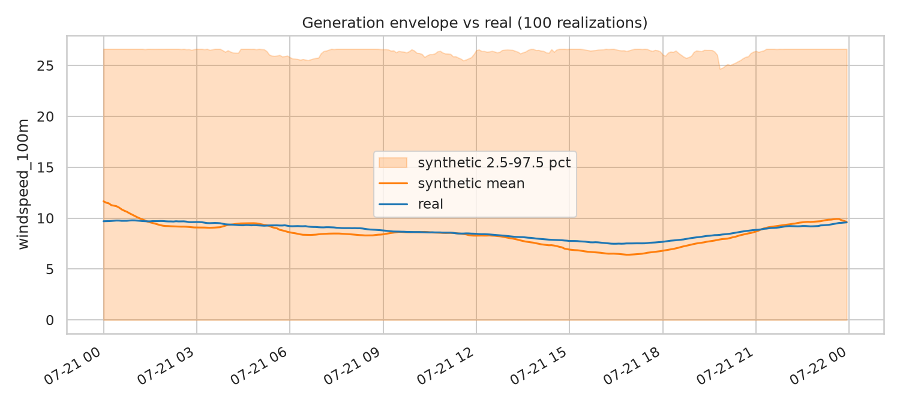
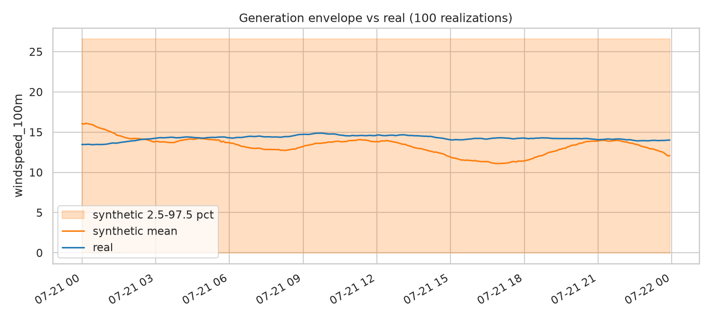
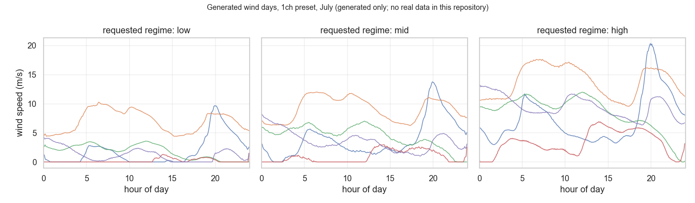

# Wind Model

`enerdatasynth.model("wind", zone=<preset>)` generates synthetic 24-hour wind profiles
at 5-minute resolution (288 steps). Profiles are conditioned on calendar, temperature
and wind regime, and there are three channel presets: `1ch`, `2ch` and `3ch`.

This report follows the same section layout as [`docs/models/pjm_load.md`](pjm_load.md).
The wind model comes from a separate diffusion pipeline that was vendored into this
package rather than built here, so the content under each heading is specific to wind.

## 1. Overview

The model generates 24-hour wind profiles at 5-minute resolution for one of three
channel presets:

- `1ch`: windspeed only
- `2ch`: wind-vector U/V components
- `3ch`: windspeed plus direction encoded as sin/cos

It is conditioned on month, day of week, a temperature-spread feature, and a wind-regime
bucket (low, mid or high). Like the load model, it generates plausible profiles for given
conditions. It does not forecast.

## 2. Input Data

This repository contains no raw wind training data. `data/raw/wind/` holds only a
placeholder README. The bundled checkpoints (§5) were trained elsewhere, on data that
isn't included here, and the preprocessing can't be reproduced from this repository.

`pyproject.toml` lists `h5py`, `h5pyd` and `python-dotenv` as dependencies, which
suggests the original data came from an HSDS source such as the NREL WIND Toolkit.
Nothing in `src/enerdatasynth/resources/wind/` uses them, though, because the
data-download step was never vendored. This is the biggest difference from the load
resource, which ships its full raw-data pipeline.

What the vendored code and manifest do record:

| Item | Value |
|---|---|
| Sequence length | 288 steps |
| Frequency | 5-minute |
| Feature columns | `windspeed_100m` (`1ch`); `windspeed_100m`, `winddirection_100m` (`2ch`/`3ch`, decomposed differently per preset) |

## 3. Data Representation

Inside the vendored package, one sample is a `(288, n_channels)` array, where
`n_channels` is 1, 2 and 2 for `1ch`, `2ch` and `3ch`. The public `.sample()` method
always returns `(N, 288, 2)` whatever the preset: `[..., 0]` is windspeed in m/s and
`[..., 1]` is direction in degrees.

## 4. Conditioning

The default conditioning fields are set in
`enerdatasynth.resources.wind.config.WindDiffusionConfig.condition_on`:

- `month`
- `day_of_week`
- `temp_min_max_spread`: a single transform derived from the min and max temperature and
  z-scored jointly, not one column per input
- `wind_regime_bucket`: one-hot by default. Each checkpoint can use ordinal encoding
  instead, which was added because `mid` steering with one-hot encoding has stayed
  near chance for `1ch` and `3ch` (§10).

This doesn't fit the `ConditionField` system that `pjm_load` uses. The set of fields
depends on the checkpoint, one field is a derived transform, and the regime encoding is
chosen per checkpoint. `ResourceModel` has a `condition_builder` option for cases like
this, and wind is currently the only resource that uses it. Unlike load (§4 of
`docs/models/pjm_load.md`), wind has only ever had one conditioning scheme, defined by
`wind_diffusion` itself.

## 5. Generative Model

The model is a conditional DDPM from the vendored `wind_diffusion` package
(`src/enerdatasynth/resources/wind/`), which came from a separate Data-For-Good research
project. It was not built or trained in this repository.

- **Denoiser:** transformer, `hidden_dim=128`, `num_heads=4` (config defaults).
- **Diffusion:** `T=200` steps with a cosine beta schedule (`beta_start=1e-4`,
  `beta_end=0.02`). Load uses a linear schedule.
- **Sampling:** DDIM with classifier-free guidance and dynamic thresholding. Load uses
  the ancestral DDPM sampler. The wind settings were tuned upstream (§8).

## 6. Training

Training happened upstream in the `wind_diffusion` project, on data this repository
doesn't include (§2). The manifest records the recipe for each bundled checkpoint:

- **`1ch` and `3ch`:** post-LN transformer (`norm_first=False`), `hidden_dim=128`,
  `warmup_epochs=8`, 60 epochs, `cond_dropout_prob=0.3`, `cond_dropout_scope="wind_regime"`.
- **`2ch`:** the same recipe plus `joint_consistency_channels=[0,1]` and
  `joint_consistency_weight=1.0`, added to fix `2ch`'s original failures (§8).

`resources/wind/manifest.json` lists every preset's `status` as `"pending"` because the
manifest's download location has nothing published. Wind still works: this package
looks for checkpoints in `data/checkpoints/wind/<preset>/` first, and all three presets
are bundled there. See
[`src/enerdatasynth/generators/README.md`](../../src/enerdatasynth/generators/README.md).

## 7. Evaluation

Wind uses its own metric suite (`enerdatasynth.resources.wind.evaluation.metrics`).
Lower is better for every metric except `regime_accuracy`.

| Metric | What it measures | Why it matters |
|---|---|---|
| `marginal_wasserstein` | Wasserstein-1 distance between real and synthetic windspeed distributions (m/s) | Overall match of the value distribution |
| `acf_rmse` | RMSE between mean real and synthetic autocorrelation curves | How long wind conditions persist |
| `spectral_low_band` / `spectral_high_band` | Log-ratio of average power spectra, split into low and high frequency bands | Whether turbulence has the right frequency content |
| `ramp_wasserstein` | Wasserstein-1 distance between real and synthetic step-to-step changes within a day | Ramp and volatility behavior (the wind version of load's `Ramp`) |
| `diurnal_rmse` | RMSE between mean daily profiles | Shape of the average daily cycle |
| `regime_accuracy` | Share of generated days whose mean windspeed falls in the requested regime bucket | Whether the `wind_regime` input actually controls the output |

## 8. Quantitative Results

These numbers come from `src/enerdatasynth/resources/wind/manifest.json`. They were
measured on 2026-07-21 against each preset's validation split, with 100 synthetic
realizations per regime.

`1ch`, the best-tuned preset (`sampler=ddim, steps=50, eta=1.0, guidance_scale=40.0`):

| Regime | n (real) | `marginal_wasserstein` | `acf_rmse` | `regime_accuracy` |
|---|---|---|---|---|
| Low | 156 | 2.25 | 0.060 | 0.69 |
| Mid | 300 | 2.00 | 0.108 | 0.41 (near chance) |
| High | 147 | 2.11 | 0.101 | 0.55 |

`3ch` (`sampler=ddim, steps=50, eta=1.0, guidance_scale=40.0`):

| Regime | `marginal_wasserstein` | `acf_rmse` | `regime_accuracy` |
|---|---|---|---|
| Low | 2.67 | 0.074 | 0.41 |
| Mid | 2.21 | 0.109 | 0.43 (near chance) |
| High | 1.16 | 0.118 | 0.82 |

`2ch` needs different generation settings (`eta=0.0`, `guidance_scale=1.0`), because
guidance breaks this preset even with dynamic thresholding on. It also needs the
joint-consistency training recipe (§6). Its first version produced windspeeds about 2.8×
too high and had almost no regime control. The fix improved it a lot, but its manifest
entry says it should not be treated as equivalent to `1ch` or `3ch`. Current per-regime
numbers for `2ch` haven't been copied into this report; see the manifest.

For `1ch` and `3ch`, `mid` is the one regime nothing has fixed. Its accuracy has never
gone above about 41–43%, barely better than the one-in-three you'd get with no
conditioning. Switching
from DDIM's default `eta=0.0` to `eta=1.0` improved `low` and `high` a lot but didn't
change `mid`.

## 9. Actual vs. Generated Examples

This repository has no real wind data (§2), so it can't produce its own
real-vs-generated figure the way [`pjm_load.md`](pjm_load.md) §9 does. The plots
below come from the upstream `wind_diffusion` project instead. They were made with
its `compare_to_real` function against its held-out validation split, using the
`1ch` checkpoint lineage bundled here, and are copied without changes. The images
don't record which generation settings were used, so don't assume they match the
recommended settings in §8.

| low | mid | high |
|---|---|---|
|  |  |  |

Each panel compares 100 generated days with the real validation days for one regime.
The orange line is the synthetic mean, the shaded area is the synthetic 2.5–97.5
percentile band, and the blue line is the mean of the real days. The date on the
x-axis is a placeholder.

How to read them:

- **Ignore the shaded band.** In every panel it runs from 0 to about 26.6 m/s all
  day. Those are the sampler's output limits: 26.6 m/s is 3.5 standard deviations
  above the training mean (`sample_clip_std=3.5` in `config.py`, with the mean and
  standard deviation from `data/checkpoints/wind/1ch/norm_stats.json`), and
  `data/transforms.py` clips negative speeds to 0. Some realizations sit at those
  limits throughout the day (see `clamp_x0` in `diffusion.py`), so the band shows
  nothing about real spread.
- **Compare the mean lines.** The `mid` synthetic mean stays within about 1 m/s of
  the real mean for most of the day. The `low` mean runs 2–3 m/s high all day, which
  fits the manifest's finding that 31% of `low`-conditioned days land in a higher
  bucket. The `high` mean drops about 3 m/s below the real mean in the afternoon.
- **A good mean doesn't mean good regime control.** `mid` has the closest mean but
  only 41% `regime_accuracy` (§8). Days that are too low and too high can average
  out.

These plots should be replaced with a figure generated from this package's own
checkpoint at its recommended settings once real wind data is available here.

### Generated examples from this package

This package's own representative output: five generated July days for each requested
regime, from the bundled `1ch` checkpoint, with one fixed seed (not a best-of-N pick).
It shows generated days only, because there is no real wind data here to put next to
them. The regime is a request, not a guarantee; §8 reports how often it is met.



**To reproduce this figure** (no data needed; the checkpoints ship in the package):

```bash
pip install enerdatasynth        # or `pip install -e .` from a clone
python examples/wind/plot_generated_samples.py
```

It takes about a minute on a CPU and writes `docs/assets/wind_generated_examples.png`.
The upstream real-vs-synthetic plots above cannot be reproduced from this repository;
they need the original `wind_diffusion` dataset (§14).

## 10. Conditional / Regime Evaluation

The per-regime tables in §8 cover this. Wind regime (low, mid, high) is the main slice
this pipeline evaluates, much as load is sliced by temperature, calendar and season.
`mid` is wind's most persistent weak spot (§8), comparable to load's weak spots in the
DOM zone and on hot days, though for different reasons.

## 11. Multi-Zone / Multi-Site Results

Not applicable. The three presets are different channel representations of the same
site and dataset, not different locations, so there is nothing like load's 17-zone
study. This repository has no multi-site wind study.

## 12. Calibration

Wind has no calibration step. Load applies a scalar bias correction after generation;
wind instead relies on each preset's tuned `recommended_generation` settings (sampler,
steps, `eta`, guidance). That is a different mechanism rather than a missing step.

## 13. Limitations

1. **No raw wind data or download pipeline.** The checkpoints work, but nothing here can
   retrain them or check them against real data.
2. **`mid` regime conditioning is unreliable.** For `1ch` and `3ch` it stays near chance
   under every generation setting tried (§8).
3. **`2ch` is not equivalent to `1ch` and `3ch`.** It has improved but hasn't been
   validated to the same standard.
4. **The manifest's `status: "pending"` is misleading.** All three presets are bundled
   locally and work (§6).
5. This repository can't produce its own real-vs-generated figure (§9). The plots
   shown there come from the upstream project, with unknown generation settings,
   and only their mean lines are useful.
6. **Only `units="m/s"` is supported.** The vendored evaluation code doesn't support
   `units="normalized"` for any preset, and there are no plans to add it.
7. **Generation is slow on CPU, and larger batches get much slower.** With `1ch` and
   default DDIM settings, `n=2` took about 6 seconds and `n=10` about 9 seconds, but
   `n=100` hadn't finished after 2.5 minutes. Use small batches, or expect a long wait;
   the process hasn't hung.

## 14. Reproduction

The wind model can't be retrained from this repository. There is no raw data, and
`enerdatasynth`'s CLI has no wind training command (load has `enerdatasynth train`).
The bundled checkpoints work for generation right away:

```python
import enerdatasynth
wind = enerdatasynth.model("wind", zone="1ch")   # or "2ch" / "3ch"
wind.set(wind_regime="mid", month=7, temp_min=10, temp_max=22)
samples = wind.sample(n=10, seed=0)              # (10, 288, 2): m/s, degrees
```

Retraining would need the original `wind_diffusion` dataset and the training code in
`src/enerdatasynth/resources/wind/training/train.py`. Some error messages mention a
`wind-diffusion-train --preset <preset> --data-path <csv> --output-dir <dir>` command
(`resources/wind/registry.py`). That command is not installed by this package; only
`enerdatasynth` is registered in `pyproject.toml`. It is how the upstream project runs
`enerdatasynth.resources.wind.training.train`. For generation parameters, see
[`docs/api_reference.md`](../api_reference.md). Runnable examples are in
[`examples/wind/`](../../examples/wind/README.md).

## 15. Intended Use and Out-of-Scope Uses

**Intended**: generating synthetic daily wind profiles at 5-minute resolution for
research on conditional generative modeling, scenario analysis, or data augmentation
where real wind measurements are limited. The conditions it responds to are the channel
preset, month, day of week, a temperature range, and the wind-regime bucket (§4).

**Out of scope**:

- **Not a forecasting model.** It does not predict wind at a real place and time (§1).
- **Not a resource-assessment, siting or bankability tool.** Nothing here has been
  checked against measurements at a real site, and this repository holds no real wind
  data to check against (§2, §13).
- **Not an operational system.** No output should inform grid operations, dispatch or
  trading.
- **Not a reliable regime controller for `mid`.** For `1ch` and `3ch` the `mid`
  request stays near chance (§8, §13). Treat the regime as a request, not a guarantee.
- **Not validated to the same standard across presets.** `2ch` has improved but is not
  equivalent to `1ch` and `3ch` (§13).
- **Not evaluated for privacy.** No re-identification analysis was done; don't treat
  generated profiles as certified anonymized data.

## 16. Ethical / Operational Considerations

Label generated profiles as synthetic in any downstream use, and don't present them as
measurements. The quantitative results in §8 are upstream-measured numbers read from
the model's manifest, not results this repository reproduced, so cite them that way.

## 17. Versioning

The package version is `enerdatasynth.__version__`. Release history is in `MIGRATION.md`,
and how releases are built and published is in `docs/packaging.md`. The wind checkpoints
are bundled in the package; their provenance is in §6 and
[`data/checkpoints/wind/README.md`](../../data/checkpoints/wind/README.md).

