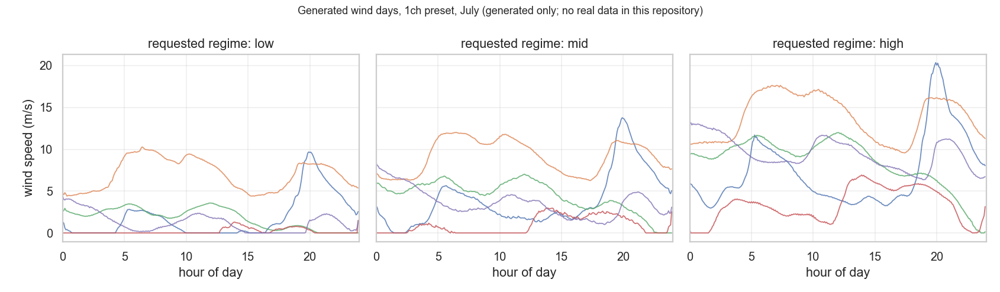

# `examples/wind/`

Runnable examples for the wind generator. They use the checkpoints that ship inside the package, so they need no data and no preprocessing. Each script's docstring ends with a **Reproduce** block giving the exact commands.

| Script | What it does | Output | Runtime |
|---|---|---|---|
| `generate_samples.py` | Generates wind days for a preset, regime and month, and prints the first as a 24-hour profile | printed | Seconds to a minute |
| `plot_generated_samples.py` | Five generated days for each regime (low, mid, high) from the `1ch` preset, from one fixed seed | `docs/assets/wind_generated_examples.png` | About a minute |

## Not available yet

- **A real-vs-generated example.** The PJM folder has `plot_real_vs_generated.py`. Wind can't have an equivalent here, because this repository has no real wind data. The real-vs-synthetic plots in [`docs/models/wind.md`](../../docs/models/wind.md) §9 come from the upstream `wind_diffusion` project instead.
- **Training, evaluation and benchmark examples.** Wind ships pre-trained and this package has no wind training command, so there is nothing to put next to PJM's `run_full_pipeline.py`, `run_all.py` or `run_benchmark.py`.

Both gaps are listed under Limitations in [`docs/models/wind.md`](../../docs/models/wind.md) §13. Load's equivalent folder is [`../pjm_load/`](../pjm_load/README.md).
